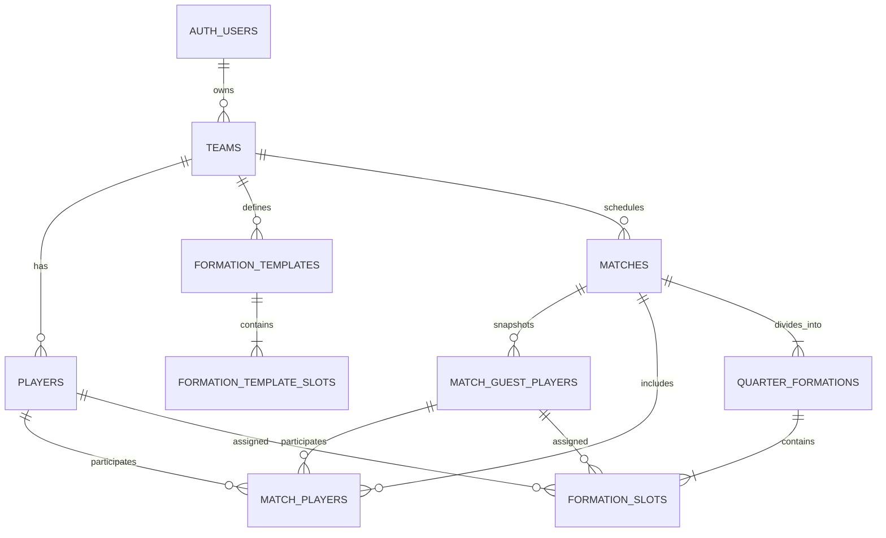

# 데이터베이스 스키마

이 문서는 KickPick 데이터베이스의 도메인 구조와 스키마 의도를 설명하는 데이터 사전이다. 실제 DB 변경은 Supabase 마이그레이션으로 관리하고, 마이그레이션이 추가되면 이 문서도 함께 갱신한다.

> **스키마 정의 확인 범위:** 현재 저장소에는 전체 테이블을 처음 생성하는 마이그레이션이 없고, 템플릿 제약/RPC 및 슬롯 저장 RPC 마이그레이션만 있다. 따라서 아래 표는 기존 프로젝트 문서와 애플리케이션 조회·저장 코드까지 대조한 스키마 요약이다. `기대 제약`으로 표시한 항목은 현재 제공된 마이그레이션만으로 실제 DB 적용 여부를 확인할 수 없다. 완전한 현행 스키마 기준을 만들려면 Supabase에서 schema dump 또는 초기 마이그레이션을 저장소에 포함해야 한다.

## 1. 관계도



`MATCH_PLAYERS`는 정식 선수 또는 경기 게스트 중 하나를 참조한다. `FORMATION_SLOTS`도 정식 선수 또는 게스트 중 하나를 배정받거나, 둘 다 비어 있는 미배정 상태일 수 있다.

## 2. 소유권과 팀 범위

```text
auth.users
└── teams (owner_user_id)
    ├── players (team_id)
    ├── formation_templates (team_id)
    │   └── formation_template_slots (formation_template_id)
    └── matches (team_id)
        ├── match_guest_players (match_id)
        ├── match_players (match_id, player_id 또는 guest_player_id)
        └── quarter_formations (match_id)
            └── formation_slots (quarter_formation_id, player_id 또는 guest_player_id)
```

- 로그인 사용자와 체험 사용자는 모두 Supabase Auth 사용자 ID를 사용하며 `teams.owner_user_id`로 소유권을 연결한다.
- 현재 앱은 사용자가 소유한 첫 번째 팀을 현재 팀으로 선택한다. 팀 전환 기능은 아직 없다.
- 자식 테이블에 `team_id`가 없으면 부모 관계를 따라 팀과 소유자를 확인한다.
- RLS는 모든 팀 데이터가 `teams.owner_user_id = auth.uid()` 소유권 체인 안에 있도록 제한해야 한다.

## 3. 열거형

### `position_code`

선수와 포메이션 슬롯이 함께 사용하는 DB enum이다. 앱 코드에서는 선수 프로필에 허용할 코드와 포메이션 슬롯에 허용할 코드를 별도 TypeScript 타입으로 좁혀 사용한다.

| 구분                 | 값                                                 |
| -------------------- | -------------------------------------------------- |
| 골키퍼               | `GK`                                               |
| 수비                 | `LB`, `LWB`, `LCB`, `CB`, `RCB`, `RB`, `RWB`, `RC` |
| 수비형 미드필더      | `LDM`, `CDM`, `RDM`                                |
| 중앙 미드필더        | `LCM`, `CM`, `RCM`                                 |
| 공격형/측면 미드필더 | `CAM`, `LM`, `RM`                                  |
| 공격수               | `LW`, `LF`, `CF`, `RF`, `RW`                       |

현재 코드에서 실제로 사용하는 범위는 다음과 같다.

| 용도                                     | 허용 코드                                                                              | 설명                                             |
| ---------------------------------------- | -------------------------------------------------------------------------------------- | ------------------------------------------------ |
| 선수 주·부 포지션 (`PlayerPositionCode`) | `GK`, `LB`, `LWB`, `CB`, `RB`, `RWB`, `CDM`, `CM`, `CAM`, `LM`, `RM`, `LW`, `CF`, `RW` | 선수 프로필과 게스트 입력에서 선택하는 14개 코드 |
| 템플릿 슬롯 (`FormationSlotCode`)        | 위 14개 + `LCB`, `RCB`, `RC`, `LDM`, `RDM`, `LCM`, `RCM`, `LF`, `RF`                   | 좌우/세부 슬롯까지 표현하는 23개 코드            |

예를 들어 템플릿에는 `LCB`와 `RCB` 슬롯을 각각 둘 수 있지만, 선수 프로필에는 `CB`를 저장한다. 자동 배치 로직은 슬롯 코드를 선수 코드에 대응시켜 적합도를 계산한다. 현재 대응 예시는 `LCB`/`RCB` → `CB`, `LDM`/`RDM` → `CDM`, `LCM`/`RCM` → `CM`, `LF`/`RF` → `CF`, `RC` → `RB`다.

### 포지션 코드가 화면에 전달되는 방식

현재 포지션 선택지는 DB에서 조회해 내려주는 데이터가 아니다. `src/entities/position/config/positions.ts`에 코드 목록이 정적 상수로 정의되어 있으며, 선수 입력 UI가 이 목록을 직접 import해 렌더링한다. 주 포지션 선택은 14개 전체를 보여주고, 부 포지션 검색은 같은 14개 목록을 브라우저에서 검색어로 필터링한다. 게스트 입력도 같은 목록을 사용한다.

서버 액션은 폼이 제출한 값을 그대로 신뢰하지 않고 같은 상수 목록으로 유효성을 검사한다. 즉, **목록 데이터는 코드에 고정되어 클라이언트 번들에도 포함되고, 실제 선수/게스트 행 데이터는 서버에서 Supabase를 통해 읽고 쓴다.** 여기서 클라이언트 필터링은 선수 DB 전체를 내려받아 포지션으로 필터링한다는 뜻이 아니라, 작은 고정 코드 목록을 검색어로 거르는 동작이다.

포지션 코드 목록을 DB에서 관리해야 하는 운영 요구(관리자 편집, 팀별 포지션, 배포 없이 코드 변경)가 아직 없다면, 현재처럼 공통 타입/상수로 관리하는 방식이 적절하다. 서버에서 내려주는 구조로 바꾸면 매 화면 요청과 클라이언트 상태 전달이 추가되지만, 목록이 작고 정적이어서 얻는 이점은 제한적이다. DB enum, TypeScript 타입, UI 옵션이 서로 어긋나지 않도록 변경 시 세 곳을 함께 확인해야 한다.

### `match_status`

| 값          | 의미               |
| ----------- | ------------------ |
| `draft`     | 경기 초안          |
| `generated` | 포메이션 생성 완료 |
| `completed` | 경기 완료          |

## 4. 테이블 사전

열의 nullable/default는 제공된 전체 DDL에서 확인할 수 없어 일부 생략했다. `선택`, `기본값` 등은 앱 동작 기준 설명이며 실제 DB 제약과 구분해서 확인해야 한다.

### `teams` — 팀 공간

| 컬럼            | 타입          | 설명                        |
| --------------- | ------------- | --------------------------- |
| `id`            | `uuid`        | 기본 키                     |
| `owner_user_id` | `uuid`        | 소유한 `auth.users.id`      |
| `name`          | `text`        | 팀 이름                     |
| `created_at`    | `timestamptz` | 생성 시각                   |
| `updated_at`    | `timestamptz` | 수정 시각, 갱신 트리거 사용 |

### `players` — 팀 등록 선수

선수는 삭제 시 즉시 행을 지우지 않고 `is_deleted`로 비활성 처리한다.

| 컬럼            | 타입              | 설명                                     |
| --------------- | ----------------- | ---------------------------------------- |
| `id`            | `uuid`            | 기본 키                                  |
| `team_id`       | `uuid`            | 소속 팀, `teams.id` 참조                 |
| `name`          | `text`            | 선수 이름, 공백만 입력할 수 없음         |
| `player_number` | `integer`         | 등번호, 선택                             |
| `main_position` | `position_code`   | 주 포지션                                |
| `sub_positions` | `position_code[]` | 부 포지션 목록, 기본 빈 배열             |
| `priority_rank` | `integer`         | 자동 배치 우선순위, 숫자가 낮을수록 우선 |
| `is_deleted`    | `boolean`         | 삭제/비활성 여부                         |
| `created_at`    | `timestamptz`     | 생성 시각                                |
| `updated_at`    | `timestamptz`     | 수정 시각, 갱신 트리거 사용              |

### `formation_templates` — 팀 포메이션 템플릿

신규 팀에는 `4-2-3-1`, `4-3-3`, `4-4-2` 템플릿을 기본 제공한다. 생성 이후에는 일반 팀 템플릿으로 저장되며, 사용자가 수정하거나 삭제한 템플릿을 자동 복구하지 않는다.

| 컬럼         | 타입          | 설명                        |
| ------------ | ------------- | --------------------------- |
| `id`         | `uuid`        | 기본 키                     |
| `team_id`    | `uuid`        | 소유 팀, `teams.id` 참조    |
| `name`       | `text`        | 템플릿 이름, 예: `4-3-3`    |
| `is_deleted` | `boolean`     | 삭제/비활성 여부            |
| `created_at` | `timestamptz` | 생성 시각                   |
| `updated_at` | `timestamptz` | 수정 시각, 갱신 트리거 사용 |

**기대 제약:** 삭제되지 않은 행에 대해 `(team_id, name)` 고유.

### `formation_template_slots` — 템플릿 슬롯 정의

템플릿의 기본 포지션, 순서, 필드 좌표를 저장한다.

| 컬럼                    | 타입            | 설명                                          |
| ----------------------- | --------------- | --------------------------------------------- |
| `id`                    | `uuid`          | 기본 키                                       |
| `formation_template_id` | `uuid`          | 부모 템플릿, `formation_templates.id` 참조    |
| `slot_name`             | `position_code` | 슬롯의 포지션 의미, 예: `GK`, `LCB`           |
| `sort_order`            | `integer`       | 템플릿 내 표시 순서. 현재 폼은 GK를 먼저 추가 |
| `x`                     | `numeric(5,2)`  | 필드 가로 좌표(0~100 퍼센트)                  |
| `y`                     | `numeric(5,2)`  | 필드 세로 좌표(0~100 퍼센트)                  |
| `created_at`            | `timestamptz`   | 생성 시각                                     |
| `updated_at`            | `timestamptz`   | 수정 시각, 갱신 트리거 사용                   |

**템플릿 규칙:** 템플릿당 슬롯 11개, 입력 폼은 필드 슬롯 10개를 받고 GK를 자동 추가한다. 템플릿 편집은 기존 템플릿 ID를 유지하고 `replace_formation_template` RPC로 자식 슬롯을 한 번에 교체한다.

**마이그레이션에서 확인되는 제약:** 부모 FK의 `ON DELETE CASCADE`, `(formation_template_id, sort_order)` 고유, `(formation_template_id, slot_name)` 고유, `sort_order >= 0`, `x/y` 0~100 범위.

### `matches` — 경기

| 컬럼            | 타입           | 설명                                      |
| --------------- | -------------- | ----------------------------------------- |
| `id`            | `uuid`         | 기본 키                                   |
| `team_id`       | `uuid`         | 소유 팀, `teams.id` 참조                  |
| `name`          | `text`         | 경기 이름, 선택                           |
| `match_date`    | `date`         | 경기 날짜, 선택                           |
| `quarter_count` | `integer`      | 쿼터 수, 앱 범위 1~8                      |
| `gk_fixed`      | `boolean`      | 선택한 골키퍼를 모든 쿼터에 고정할지 여부 |
| `formation`     | `text`         | 경기 생성 시 복사한 포메이션 이름         |
| `status`        | `match_status` | 경기 상태                                 |
| `created_at`    | `timestamptz`  | 생성 시각                                 |
| `updated_at`    | `timestamptz`  | 수정 시각, 갱신 트리거 사용               |

현재 경기에는 템플릿 ID 대신 포메이션 이름이 저장된다. 쿼터 슬롯은 템플릿 값을 경기 생성 시 복사하므로, 이후 템플릿 변경과 기존 경기 배치가 분리된다.

### `match_guest_players` — 경기 전용 게스트

팀 등록 선수와 별도로, 특정 경기에만 사용하는 게스트 정보의 스냅샷이다. 경기 삭제 시 함께 삭제되는 관계가 기대된다.

| 컬럼            | 타입              | 설명                         |
| --------------- | ----------------- | ---------------------------- |
| `id`            | `uuid`            | 기본 키                      |
| `match_id`      | `uuid`            | 소속 경기, `matches.id` 참조 |
| `name`          | `text`            | 이름, 필수·공백 불가         |
| `player_number` | `integer`         | 등번호, 선택                 |
| `main_position` | `position_code`   | 주 포지션                    |
| `sub_positions` | `position_code[]` | 부 포지션 목록, 기본 빈 배열 |
| `priority_rank` | `integer`         | 자동 배치 우선순위           |
| `created_at`    | `timestamptz`     | 생성 시각                    |

### `match_players` — 경기 참가자 연결

경기에 등록 선수를 참가시키거나 게스트를 연결하는 조인 테이블이다.

| 컬럼               | 타입          | 설명                                         |
| ------------------ | ------------- | -------------------------------------------- |
| `match_id`         | `uuid`        | 경기, `matches.id` 참조                      |
| `player_id`        | `uuid`        | 등록 선수 참조, 게스트 참가면 비어 있음      |
| `guest_player_id`  | `uuid`        | 경기 게스트 참조, 등록 선수 참가면 비어 있음 |
| `target_quota`     | `integer`     | 자동 배치가 목표로 삼는 출전 슬롯 수         |
| `is_reduced_quota` | `boolean`     | 출전량을 줄이도록 선택했는지 여부            |
| `created_at`       | `timestamptz` | 생성 시각                                    |

**기대 제약:** `player_id`와 `guest_player_id` 중 정확히 하나만 지정. `(match_id, player_id)`와 `(match_id, guest_player_id)` 각각 부분 고유.

**골키퍼 고정 규칙:** 고정 골키퍼의 목표 출전량은 쿼터 수와 같다. 고정 골키퍼는 출전량 축소 대상이 될 수 없다. GK 고정 경기에서는 다른 선수의 목표 출전량을 필드 슬롯 수 기준으로 계산한다.

### `quarter_formations` — 경기 쿼터

| 컬럼             | 타입          | 설명                         |
| ---------------- | ------------- | ---------------------------- |
| `id`             | `uuid`        | 기본 키                      |
| `match_id`       | `uuid`        | 소속 경기, `matches.id` 참조 |
| `quarter_number` | `integer`     | 쿼터 번호, 1부터 시작        |
| `created_at`     | `timestamptz` | 생성 시각                    |
| `updated_at`     | `timestamptz` | 수정 시각, 갱신 트리거 사용  |

**기대 제약:** `(match_id, quarter_number)` 고유.

### `formation_slots` — 쿼터별 슬롯과 배정

각 행은 특정 쿼터에 있는 포지션 슬롯 하나와 현재 선수 배정을 나타낸다. `slot_name/x/y`는 템플릿에서 복사된 경기별 값이라 템플릿과 값이 중복될 수 있지만, 경기 편집 및 템플릿 변경과의 독립성을 유지한다.

| 컬럼                   | 타입            | 설명                                       |
| ---------------------- | --------------- | ------------------------------------------ |
| `id`                   | `uuid`          | 기본 키. 편집기 저장 시 슬롯 식별자로 사용 |
| `quarter_formation_id` | `uuid`          | 소속 쿼터, `quarter_formations.id` 참조    |
| `slot_name`            | `position_code` | 슬롯이 요구하는 포지션 의미                |
| `x`                    | `numeric(5,2)`  | 경기 필드 가로 좌표(0~100 퍼센트)          |
| `y`                    | `numeric(5,2)`  | 경기 필드 세로 좌표(0~100 퍼센트)          |
| `player_id`            | `uuid`          | 배정된 등록 선수, 선택                     |
| `guest_player_id`      | `uuid`          | 배정된 게스트, 선택                        |
| `fit_score`            | `integer`       | 슬롯과 선수의 포지션 적합도(0~10), 선택    |
| `is_manual`            | `boolean`       | 사용자가 수동 변경한 슬롯인지 여부         |
| `created_at`           | `timestamptz`   | 생성 시각                                  |
| `updated_at`           | `timestamptz`   | 수정 시각, 갱신 트리거 사용                |

`x/y`는 화면 그리기, `slot_name`은 포지션 적합도 계산과 슬롯 간 대응에 사용한다. 미배정이면 두 선수 ID가 모두 비어 있을 수 있다. 둘 다 채우는 것은 허용하면 안 된다.

## 5. DB 함수(RPC)

RPC(Remote Procedure Call)는 클라이언트/서버 코드가 DB에 정의된 함수를 호출하는 방식이다. 여기서는 Supabase `.rpc()`를 통해 Postgres 함수를 호출한다. Postgres 함수 호출은 한 트랜잭션에서 처리되므로 여러 행을 한꺼번에 반영하거나 전체를 되돌릴 수 있다.

### `save_formation_slots(p_match_id uuid, p_slots jsonb)`

경기 슬롯 전체의 선수 배정과 편집 메타데이터를 원자적으로 저장한다.

| 항목 | 동작                                                                                                                      |
| ---- | ------------------------------------------------------------------------------------------------------------------------- |
| 입력 | 경기 ID와 슬롯 배열(JSON): 슬롯 ID, 선수/게스트 ID, 적합도, 수동 변경 여부                                                |
| 검사 | 배열인지, 슬롯 ID가 중복되지 않는지, 경기의 전체 슬롯 수와 일치하는지, 한 슬롯에 선수와 게스트가 동시에 지정되지 않았는지 |
| 갱신 | `player_id`, `guest_player_id`, `fit_score`, `is_manual`                                                                  |
| 실패 | 오류를 발생시켜 전체 트랜잭션 취소                                                                                        |
| 권한 | `SECURITY INVOKER`; `public`, `anon` 실행 권한 회수, `authenticated`, `service_role` 허용                                 |

현재 함수는 `slot_name`과 `x/y`를 갱신하지 않는다. 슬롯 구조 자체를 바꾸는 재배정 흐름과 선수 배정만 저장하는 편집기 저장 흐름이 분리되어 있다.

### `replace_formation_template(p_template_id uuid, p_name text, p_slots jsonb)`

템플릿 이름과 슬롯 11개를 원자적으로 교체한다.

| 항목 | 동작                                                                                                                         |
| ---- | ---------------------------------------------------------------------------------------------------------------------------- |
| 검사 | 현재 사용자의 활성 팀 템플릿인지, 이름이 비어 있지 않은지, 슬롯 11개인지, 포지션/순서 중복이 없는지, GK 포함 여부, 좌표 범위 |
| 갱신 | 템플릿 이름 변경, 기존 템플릿 슬롯 삭제, 새 슬롯 삽입                                                                        |
| 실패 | 전체 트랜잭션 취소                                                                                                           |
| 권한 | `SECURITY INVOKER`; 마이그레이션에서 `anon` 실행 권한 회수                                                                   |

## 6. 인덱스·제약 요약

아래 중 템플릿 관련 항목은 저장소 마이그레이션에서 확인된다. 나머지 “기대” 항목은 전체 DDL을 확보한 뒤 실제 적용 여부를 검증해야 한다.

| 대상                       | 제약/인덱스                                             | 상태              |
| -------------------------- | ------------------------------------------------------- | ----------------- |
| `formation_templates`      | 활성 템플릿 `(team_id, name)` 고유                      | 마이그레이션 확인 |
| `formation_template_slots` | `(formation_template_id, sort_order)` 고유              | 마이그레이션 확인 |
| `formation_template_slots` | `(formation_template_id, slot_name)` 고유               | 마이그레이션 확인 |
| `formation_template_slots` | 순서 0 이상, `x/y` 0~100                                | 마이그레이션 확인 |
| `match_players`            | 경기+선수 또는 경기+게스트 고유, 둘 중 하나 필수        | 스키마 기대사항   |
| `quarter_formations`       | 경기+쿼터 번호 고유                                     | 스키마 기대사항   |
| `formation_slots`          | 쿼터 삭제 시 슬롯 연쇄 삭제, 선수/게스트 동시 배정 금지 | 스키마 기대사항   |

## 7. RLS 정책 기준

모든 테이블은 RLS를 활성화하고, 다음 소유권 관계로 접근을 제한한다.

| 테이블                                                       | 소유권 확인 경로                              |
| ------------------------------------------------------------ | --------------------------------------------- |
| `teams`                                                      | `owner_user_id = auth.uid()`                  |
| `players`, `formation_templates`, `matches`                  | 행의 `team_id`가 현재 사용자 소유 팀인지 확인 |
| `formation_template_slots`                                   | 템플릿 → 팀 → 사용자 소유권 확인              |
| `match_guest_players`, `match_players`, `quarter_formations` | 경기 → 팀 → 사용자 소유권 확인                |
| `formation_slots`                                            | 슬롯 → 쿼터 → 경기 → 팀 → 사용자 소유권 확인  |

참가자나 슬롯 배정을 추가·수정할 때는 연결된 등록 선수/게스트가 같은 팀 또는 같은 경기에 속하는지도 확인해야 한다. 특히 게스트는 해당 경기의 `match_guest_players` 행이어야 한다.

## 8. 관련 소스

| 목적                    | 파일                                                                         |
| ----------------------- | ---------------------------------------------------------------------------- |
| 템플릿 제약 강화        | `supabase/migrations/20260808083626_harden_formation_templates.sql`          |
| 템플릿 수정 RPC         | `supabase/migrations/20260809052438_add_replace_formation_template_rpc.sql`  |
| 슬롯 전체 저장 RPC      | `supabase/migrations/20261115105049_add_atomic_save_formation_slots_rpc.sql` |
| 경기 편집기 데이터 조회 | `src/features/formation-editor/api/formationEditorQueries.ts`                |
| 경기 편집기 저장        | `src/features/formation-editor/api/formationEditorMutations.ts`              |
| 편집기 DB row 타입      | `src/features/formation-editor/api/formationEditorRows.ts`                   |
| 편집기 row 변환         | `src/features/formation-editor/lib/formationEditorMappers.ts`                |
